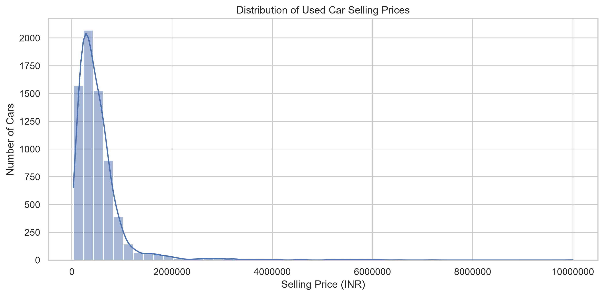
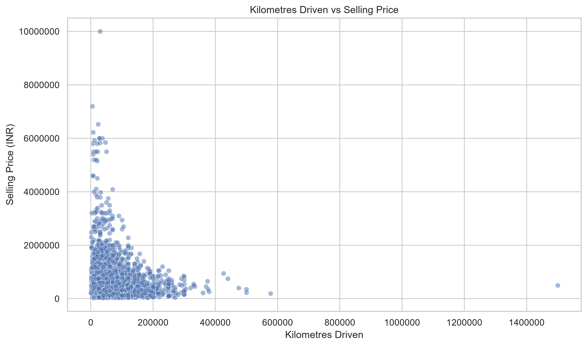
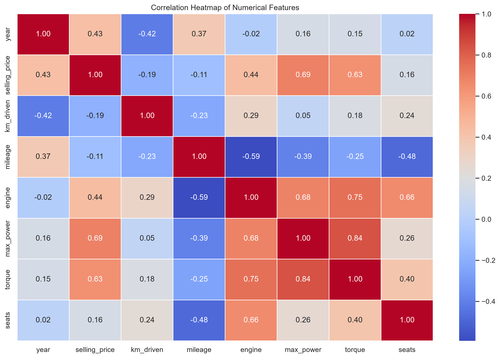

# Used Car Price Prediction Using Machine Learning Regression

## Project Overview

Used Car Price Prediction is a machine learning regression project that predicts the selling price of pre-owned vehicles based on their specifications and characteristics.

The project uses the CarDekho used car dataset and applies data cleaning, exploratory data analysis, feature engineering, and machine learning techniques to understand the factors influencing used car prices.

Four regression models are implemented and evaluated: Linear Regression, Decision Tree Regression, Random Forest Regression, and Tuned Random Forest Regression.

Based on the evaluation results, the Original Random Forest Regressor was selected as the final model.

## Objectives

* Analyse the factors affecting used car selling prices.
* Perform data cleaning and preprocessing.
* Explore relationships between vehicle characteristics and selling prices.
* Apply feature engineering to extract useful information.
* Train and compare multiple regression algorithms.
* Evaluate model performance using standard regression metrics.
* Develop a reusable machine learning pipeline.
* Save the trained model for future predictions.

## Dataset Information

**Dataset:** CarDekho Used Car Dataset
**File:** `Car details v3.csv`
**Original Records:** 8,128
**Original Features:** 13
**Records After Cleaning:** 6,925

The dataset contains information about used vehicles, including their manufacturing year, kilometres driven, fuel type, transmission, ownership, engine specifications, and selling price.

### Important Features

| Feature       | Description                                    |
| ------------- | ---------------------------------------------- |
| name          | Vehicle model name                             |
| year          | Manufacturing year                             |
| selling_price | Selling price of the vehicle (target variable) |
| km_driven     | Total kilometres driven                        |
| fuel          | Fuel type                                      |
| seller_type   | Type of seller                                 |
| transmission  | Manual or automatic                            |
| owner         | Previous ownership category                    |
| mileage       | Vehicle mileage                                |
| engine        | Engine capacity in CC                          |
| max_power     | Maximum engine power                           |
| torque        | Engine torque                                  |
| seats         | Seating capacity                               |

Additional features, including manufacturer and mileage unit, were extracted during feature engineering.

## Technologies and Libraries

### Programming Language

* Python

### Libraries

* Pandas – Data manipulation and analysis
* NumPy – Numerical computations
* Matplotlib – Data visualization
* Seaborn – Statistical visualization
* Scikit-learn – Machine learning and preprocessing
* Joblib – Model serialization and saving
* Jupyter Notebook – Development and experimentation

## Project Structure

```text
Used-Car-Price-Prediction/
│
├── data/
│   ├── raw/
│   │   └── Car details v3.csv
│   │
│   └── processed/
│       └── used_car_price_processed.csv
│
├── notebooks/
│   └── used_car_price_prediction.ipynb
│
├── src/
│   └── (Source code files, if applicable)
│
├── models/
│   └── used_car_price_model.joblib
│
├── reports/
│   ├── figures/
│   │   ├── selling_price_distribution.png
│   │   ├── year_vs_selling_price.png
│   │   ├── km_driven_vs_selling_price.png
│   │   ├── fuel_type_vs_selling_price.png
│   │   ├── seller_type_vs_selling_price.png
│   │   ├── transmission_vs_selling_price.png
│   │   ├── owner_type_vs_selling_price.png
│   │   ├── correlation_heatmap.png
│   │   └── feature_importance.png
│   │
│   └── Used_Car_Price_Prediction_Report.pdf
│
├── requirements.txt
│
├── README.md
│
└── .gitignore
```

## Methodology

The project follows a structured machine learning workflow.

### 1. Data Collection

The CarDekho used car dataset was loaded into a Pandas DataFrame for analysis.

### 2. Data Cleaning

* Identified and removed duplicate records.
* Investigated missing values.
* Converted vehicle specifications into numerical formats.
* Identified invalid values in mileage and maximum power.
* Investigated extreme kilometre readings and excluded one potentially erroneous record.

### 3. Feature Engineering

* Extracted vehicle manufacturers from vehicle names.
* Extracted numerical mileage values and their units.
* Converted engine capacity, maximum power, and torque into numerical features.
* Prepared numerical and categorical features for machine learning.

### 4. Exploratory Data Analysis

Analysed the relationships between selling price and:

* Manufacturing year
* Kilometres driven
* Fuel type
* Seller type
* Transmission type
* Previous ownership
* Engine specifications

Numerical correlations and feature relationships were also investigated using statistical analysis and visualizations.

### 5. Visualizations

The project includes several visualizations to understand the distribution of used car prices and explore the relationships between vehicle characteristics and selling prices.

#### Selling Price Distribution



#### Manufacturing Year vs Selling Price


#### Kilometres Driven vs Selling Price



#### Correlation Heatmap



#### Additional Visualizations

The following visualizations are also available in the `reports/figures/` directory:

* Fuel Type vs Selling Price
* Seller Type vs Selling Price
* Transmission Type vs Selling Price
* Owner Type vs Selling Price
* Random Forest Feature Importance

### 6. Data Preprocessing

Numerical and categorical features were processed separately.

**Numerical features:**

* Missing values were handled using median imputation.
* StandardScaler was applied for feature scaling.

**Categorical features:**

* Missing values were handled using most-frequent imputation.
* OneHotEncoder was used to convert categorical variables into numerical representations.

A ColumnTransformer and Pipeline were used to combine these operations.

### 7. Model Training

The following regression algorithms were implemented:

1. Linear Regression
2. Decision Tree Regression
3. Random Forest Regression
4. Tuned Random Forest Regression

The dataset was divided into 80% training data and 20% testing data.

### 8. Hyperparameter Tuning

RandomizedSearchCV with five-fold cross-validation was used to explore different Random Forest hyperparameter combinations.

The original and tuned Random Forest models were compared using the test dataset.

### 9. Model Evaluation

The models were evaluated using:

* Mean Absolute Error (MAE)
* Root Mean Squared Error (RMSE)
* R² Score

## Model Performance

The following results were obtained on the test dataset:

| Model                    |    MAE (₹) |   RMSE (₹) | R² Score |
| ------------------------ | ---------: | ---------: | -------: |
| Linear Regression        | 134,109.10 | 263,647.10 |   0.7152 |
| Decision Tree Regression |  96,463.49 | 196,234.42 |   0.8422 |
| Original Random Forest   |  71,381.00 | 138,354.48 |   0.9216 |
| Tuned Random Forest      |  71,183.91 | 139,522.43 |   0.9202 |

### Selected Model: Original Random Forest Regressor

The Original Random Forest Regressor was selected based on its overall test performance.

* **MAE:** ₹71,381.00
* **RMSE:** ₹138,354.48
* **R² Score:** 0.9216

The model achieved an R² score of 0.9216, indicating that it explains approximately 92.16% of the variation in selling prices in the test dataset.

Although the tuned model achieved a slightly lower MAE, the original Random Forest performed better in terms of RMSE and R².

## Model Saving and Prediction

The final preprocessing and regression steps were combined into a single Scikit-learn Pipeline.

The trained pipeline was saved using Joblib:

```python
import joblib

joblib.dump(final_model, "models/used_car_price_model.joblib")
```

The saved model can be loaded for future predictions:

```python
import joblib

loaded_model = joblib.load(
    "models/used_car_price_model.joblib"
)
```

### Sample Prediction

A sample vehicle with the following specifications was provided to the saved model:

* Manufacturing Year: 2018
* Kilometres Driven: 50,000
* Fuel Type: Petrol
* Transmission: Manual
* Ownership: First Owner
* Mileage: 18.9 kmpl
* Engine: 1197 CC
* Maximum Power: 82 bhp
* Torque: 113 Nm
* Seating Capacity: 5
* Manufacturer: Maruti

**Predicted Selling Price: ₹5,01,389.97**

This demonstrates that the saved pipeline can accept new vehicle specifications and generate a price prediction.

## How to Run the Project

### 1. Clone the Repository

```bash
git clone https://github.com/KunalGupta9321/Used-Car-Price-Prediction
```

### 2. Navigate to the Project Directory

```bash
cd Used-Car-Price-Prediction
```

### 3. Create a Virtual Environment

```bash
python -m venv Task3
```

### 4. Activate the Environment

For Windows PowerShell:

```powershell
.\Task3\Scripts\Activate.ps1
```

### 5. Install Dependencies

```bash
pip install -r requirements.txt
```

### 6. Launch Jupyter Notebook

```bash
jupyter notebook
```

Open:

`notebooks/used_car_price_prediction.ipynb`

Run the notebook cells sequentially to reproduce the analysis and model training.

**Note:** Place the original dataset in `data/raw/` before running the notebook. The saved model is included separately for prediction use.

### 7. Running the Interactive Prediction Script

The project includes an interactive Python script that allows users to predict the estimated selling price of a used car by entering its specifications.

Run the following command from the project root directory:

```bash
python src/predict.py
```

## Future Improvements

* Develop an interactive web application for price prediction.
* Experiment with additional regression algorithms.
* Perform more extensive cross-validation and model optimization.
* Investigate methods to reduce prediction errors.
* Incorporate additional vehicle features and more recent market data.
* Evaluate model performance on newer vehicle listings.

## Conclusion

This project demonstrates an end-to-end machine learning regression workflow for used car price prediction.

Through data cleaning, exploratory data analysis, feature engineering, preprocessing, model training, and evaluation, the Original Random Forest Regressor achieved the best overall performance among the evaluated models.

The final trained pipeline was saved using Joblib and successfully tested with new vehicle specifications.

The project provides a foundation for developing a more comprehensive used car price prediction application.
